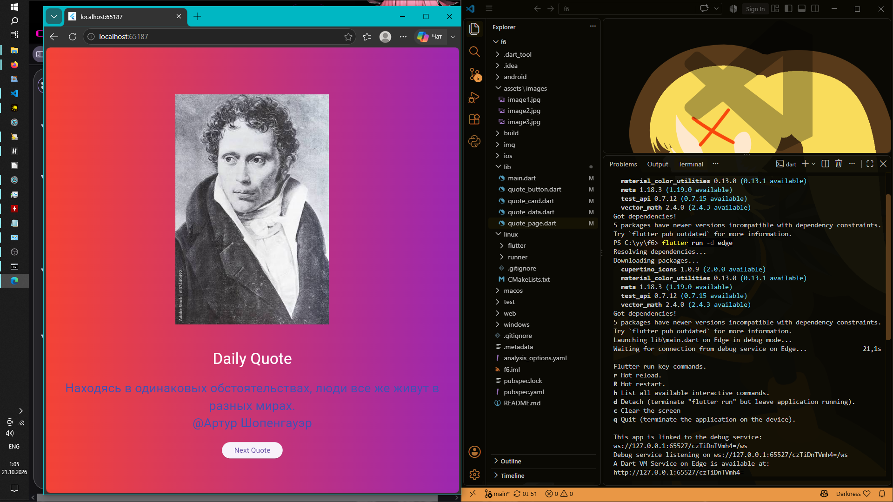

# Flutter 6 

Самостоятельное веб-приложение на Flutter, разработанное в рамках Лабораторной работы №6.

## Описание проекта
Приложение отображает случайную  цитату из заранее подготовленного списка. Пользователь может переключить цитату нажатием на кнопку, при этом меняется не только текст, но и сопутствующее изображение (ассет). Интерфейс оформлен с использованием приятного кастомного градиентного фона.


## Автор
    Имя: Чумаченко Михаил
    Группа: ИСП-242


## Стек технологий 
    Framework: Flutter 3.47.7
    Language: Dart 3.13.5
    Платформа: Web (Edge)
    IDE: Visual Studio Code 


## Скриншот приложения



## Структура проекта (папка lib/)
В соответствии с техническим заданием код разбит на отдельные файлы и содержит как минимум 3 собственных виджет-класса:

* `lib/main.dart` 
* `lib/quote_button.dart` 
* `lib/quote_card.dart` 
* `lib/quote_data.dart`
* `lib/quote_page.dart`  


## Как запустить 

1. Склонируйте репозиторий:
   ```bash
   git clone <url>
   ```
2. Перейдите в папку проекта:
   ```bash
   cd f6
   ```
3. Загрузите зависимости и подключите ассеты:
   ```bash
   flutter pub get
   ```
4. Запустите приложение в браузере Edge:
   ```bash
   flutter run -d edge
   ```


## Что я изучил в ходе выполнения работы
1. **Декомпозиция UI:** Научился разделять интерфейс на независимые переиспользуемые виджет-классы и разносить их по разным файлам в структуре `lib/`.
2. **Управление состоянием:** Закрепил навыки работы со `StatefulWidget` и методом `setState()` для динамического обновления экрана при действиях пользователя.
3. **Работа с ресурсами:** Освоил правильное подключение локальных изображений (ассетов) через конфигурационный файл `pubspec.yaml`.
4. **Визуальное оформление:** Научился создавать кастомные градиенты (`LinearGradient`) для улучшения внешнего вида интерфейса.
5. **Интеграция системных библиотек:** Использовал встроенный пакет `dart:math` (класс `Random`) для реализации элемента случайности при выборе цитат.


